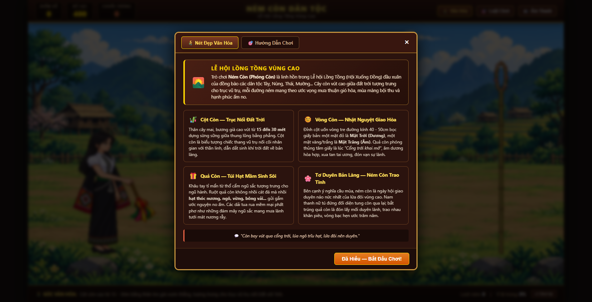
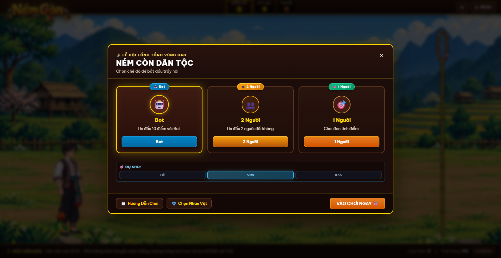
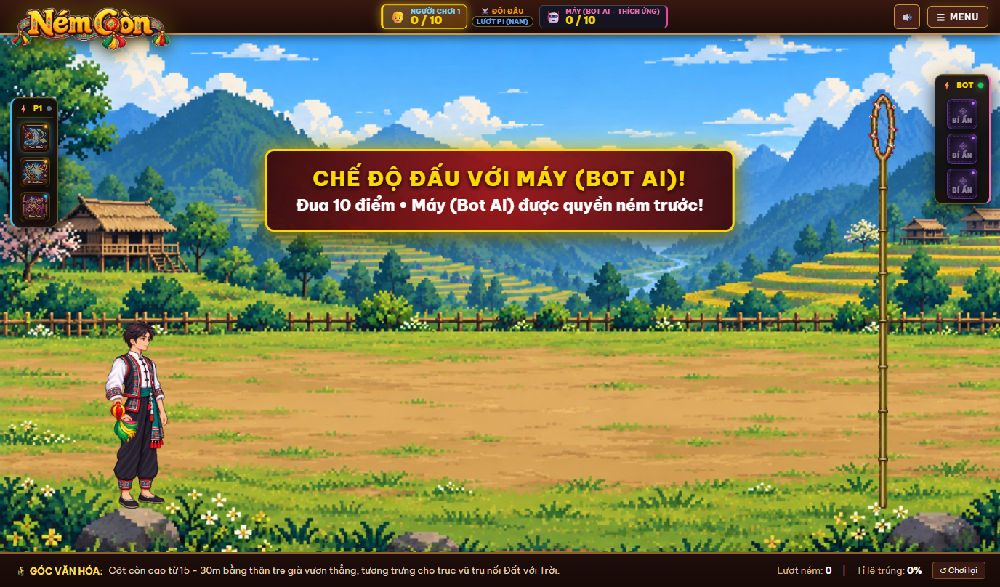

# 🎯 Ném Còn Dân Tộc — Lễ Hội Lồng Tồng Vùng Cao
> **Trò chơi dân gian Việt Nam tôn vinh di sản văn hóa truyền thống Tây Bắc trên nền web (HTML5 Canvas 2D & Web Audio API)**

[](https://vlantoy.github.io/nem-con-game/)
[](https://developer.mozilla.org/en-US/docs/Web/JavaScript)
[](LICENSE)

---

## 🌾 Chiều Sâu Văn Hóa & Phong Tục Ném Còn

**Ném Còn (Phóng Còn)** là một trong những nét sinh hoạt văn hóa tinh thần đặc sắc và thiêng liêng nhất của đồng bào các dân tộc vùng cao Tây Bắc, Đông Bắc (Tày, Nùng, Thái, Mường...) mỗi độ xuân về trong **Lễ hội Lồng Tồng (Hội Xuống Đồng)**.



### 1. 🎋 Cột Còn — Trục Vũ Trụ Nối Liền Đất Trời
Cột còn được dựng từ thân cây mai, bương già thẳng tắp, cao từ **15 đến 30 mét** sừng sững giữa thung lũng bãi hội. Cột còn tượng trưng cho **trục vũ trụ** — chiếc cầu nối tâm linh nối liền cõi trần gian với cõi thần linh, dẫn dắt sinh khí đất trời giao hòa, xua tan tai ương và mang mưa thuận gió hòa về bản làng.

### 2. 🌞 Vòng Còn — Nhật Nguyệt Giao Hòa & Khai Mở Cổng Trời
Trên đỉnh cột tre uốn một vòng tròn đường kính 40 - 50cm, dán kín bằng giấy bản:
* Mặt hướng đông dán giấy đỏ tượng trưng cho **Mặt Trời (Dương)**.
* Mặt hướng tây dán giấy vàng/trắng tượng trưng cho **Mặt Trăng (Âm)**.

Khoảnh khắc quả còn phóng xuyên thủng tâm giấy vòng còn là giây phút bùng nổ nhất lễ hội: biểu trưng cho **"Cổng trời đã khai mở"**, âm dương hòa quyện, báo hiệu một năm mới mưa thuận gió hòa, mùa màng bội thu.

### 3. 🎁 Quả Còn Ngũ Sắc — Túi Hạt Mầm No Ấm
Quả còn được các thiếu nữ khâu tay tỉ mỉ từ những múi vải thổ cẩm mang 5 sắc màu biểu trưng cho **Ngũ hành**:
* **Ruột quả còn:** Nhồi các **hạt giống nông nghiệp quý** (thóc nương, ngô, vừng, đỗ...) gửi gắm ước nguyện về sự sinh sôi, no ấm.
* **Tua rua ngũ sắc:** Rủ dài mềm mại như những dải mây ngũ sắc mang mưa lành tưới tắm nương ngô.
* Người ném trúng hoặc đón bắt được quả còn sẽ mang các hạt giống bên trong về trộn với thóc giống gia đình để lấy vía may mắn cho mùa vụ mới.

### 4. 🌸 Tơ Duyên Bản Làng — Ném Còn Trao Tình
Bên cạnh ý nghĩa tâm linh mùa màng, ném còn là ngày hội giao duyên rộn rã. Các nam thanh nữ tú mặc trang phục thổ cẩm đẹp nhất, đứng đối diện nhau qua bãi hội tung quả còn qua lại. Đón bắt trúng quả còn là trao gửi lời hẹn ước, nên duyên vợ chồng trăm năm.

---

## 🎮 Các Chế Độ Chơi

### 1. 🏹 Chế Độ Luyện Tập (Single Player & Adaptive AI Bot)
Trải nghiệm ném còn truyền thống với giao diện tối giản, tập trung hoàn toàn vào kỹ năng căn góc và lực xoay.



* **3 Cấp độ thử thách:** `Dễ` (vành mây hỗ trợ), `Vừa` (vành chuẩn truyền thống), `Khó` (cột còn di chuyển/dao động).
* **Real-time Adaptive AI Bot:** Trình độ của Bot tự động tính toán và bám sát tỉ lệ ném trúng theo thời gian thực của người chơi, tạo cảm giác thi đấu cân bằng, kịch tính.
* **Giao diện sạch mắt:** Không chữ thừa, chỉ thị trực quan bằng đường đứt nét khí động học và tâm nhắm thời gian thực (Future Reticle).

### 2. ⚔️ Chế Độ Đối Kháng Lễ Hội (PVP Card Battler)
Cuộc so tài đỉnh cao giữa 2 người chơi (hoặc Đấu với Máy) với bàn cờ chiến thuật thẻ bài độc đáo.



* **Hệ thống 37 Thẻ Bài Kỹ Năng Độc Đáo:**
  * ⚡ **Tấn Công & Tích Lũy Điểm:** *Tích Điểm, Nhân Đôi, Tăng Điểm, Song Ném, Ném Bù, Thách Đấu, Vật Lý Ấn Độ...*
  * 🛡️ **Phòng Ngự & Hóa Giải:** *Khiên Chắn, Thanh Tẩy, Giải Trừ, Hấp Thụ, Bảo Toàn, Bất Khuất, Phản Chiếu...*
  * 🌪️ **Gây Nhiễu & Khống Chế:** *Bẻ Cong Quỹ Đạo, Ảo Ảnh 3 Cột, Lá Bàn Nói Dối, Mưa Nặng Hạt, Hoa Mắt, Bóng Đêm, Bẫy Ngầm...*
  * 🔄 **Can Thiệp Lượt & Nhịp Độ:** *Cướp Lượt, Chiếm Nhịp, Đổi Lượt, Hoán Đổi, Hủy Bài, Phạt Kép, Đảo Ngược...*
  * 🎲 **Cược Điểm & Đột Phá:** *Đặt Cược Điểm Số, Cược Điểm, Cướp Cơ Hội, Lá Bài Bí Ẩn, Luật Ngược Đời...*
* **Thanh Áp Lực Thời Gian (Action Timer):** Căn nhịp chọn bài và vào đà xoay chuẩn xác trước khi hết lượt.
* **Bí Mật Đối Kháng:** Thẻ bài sử dụng được giữ kín hiệu ứng cho đến khi đối thủ phát lực ném, tạo nên những pha "lật kèo" mãn nhãn.

---

## 🔬 Cơ Chế Vật Lý & Công Nghệ

### 1. Hệ Thống Vật Lý Quỹ Đạo Chân Thực
* **Gia tốc trọng trường:** $g = 380\text{ px/s}^2$ tạo đường rơi đầm tay, vồng cung parabol hoàn toàn tự nhiên.
* **Lực cản khí động học (Aerodynamic drag):** Mô phỏng lực cản không khí tác động lên quả còn và các dải tua rua chuyển động mềm mại theo nguyên lý Inverse Kinematics & Bezier Curves.
* **Va chạm liên tục (Continuous Collision Detection - CCD):** Tính toán va chạm chính xác từng mili-giây giữa quả còn với tâm vòng còn, mép vành tre và thân cột bương già.

### 2. Hoạt Họa Khung Xương 2D (Dynamic 2D Skeletal Rigging)
* Mô hình nhân vật chia tách đa khớp nối (*Thân, Bắp tay, Cẳng tay, Bàn tay*).
* Cánh tay co duỗi xoay tròn mượt mà 60 FPS theo góc đà vẩy chuột/cảm ứng, đồng bộ hoàn hảo tọa độ điểm buông quả còn từ lòng bàn tay.

### 3. Âm Thanh Tổng Hợp Thuần Túy (Web Audio API)
* 100% âm thanh được sinh động theo thời gian thực bằng thuật toán dao động sóng âm (Oscillator & Pink Noise) — **hoàn toàn không cần tải file audio ngoài**:
  * Tiếng gió rít (*whistle whoosh*) tăng dần theo tốc độ xoay quả còn.
  * Tiếng phát lực vung tay dứt khoát khi buông còn.
  * Tiếng lách cách chân thực khi quả còn va quẹt vào vành tre.
  * Hồi trống hội vang dội hòa cùng âm sắc ngũ cung Đàn Tính rộn rã khi ném xuyên tâm vòng.

---

## 🚀 Cài Đặt & Chạy Cục Bộ (Local)

Game được tối ưu hóa dạng **Zero-Build Vanilla Web** (không cần Node build tools hay cài đặt thư viện nặng nề):

```bash
# 1. Clone repository
git clone https://github.com/Vlantoy/nem-con-game.git
cd nem-con-game

# 2. Khởi chạy máy chủ tĩnh cục bộ bằng Python
python -m http.server 8080

# 3. Mở trình duyệt và trải nghiệm
# http://localhost:8080 (hoặc http://127.0.0.1:8080)
```

Hoặc trải nghiệm trực tiếp trên nền web GitHub Pages:  
👉 **[https://vlantoy.github.io/nem-con-game/](https://vlantoy.github.io/nem-con-game/)**

---

## 📜 Giấy Phép (License)

Dự án phát hành theo giấy phép [MIT License](LICENSE). Tự do học tập, trải nghiệm và lan tỏa nét đẹp văn hóa dân gian Việt Nam!
